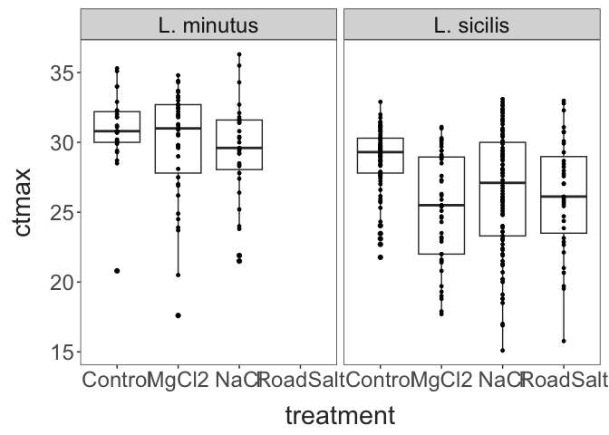
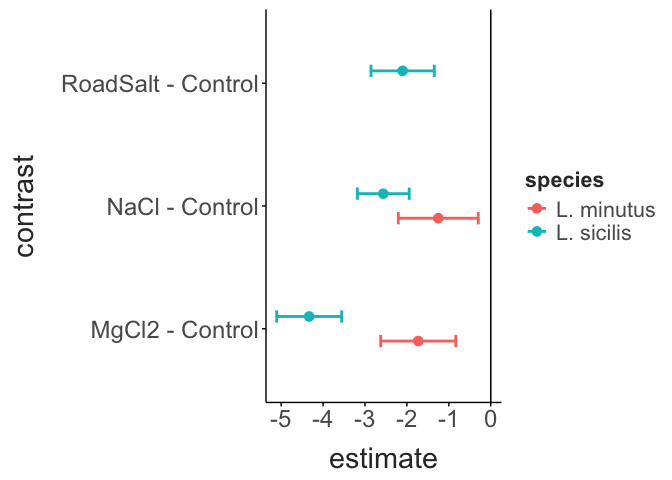
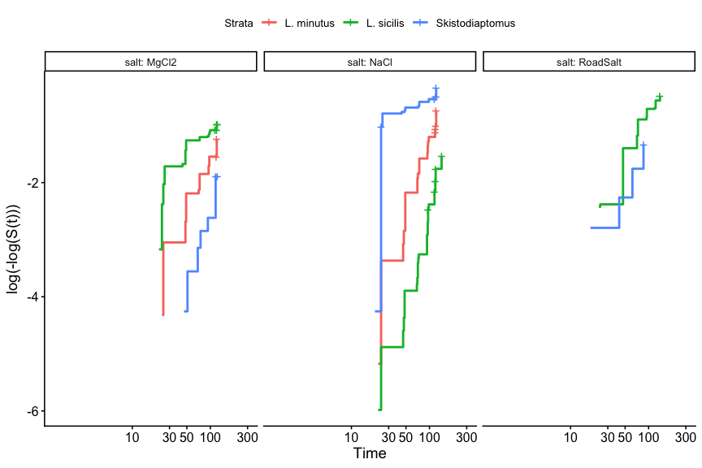
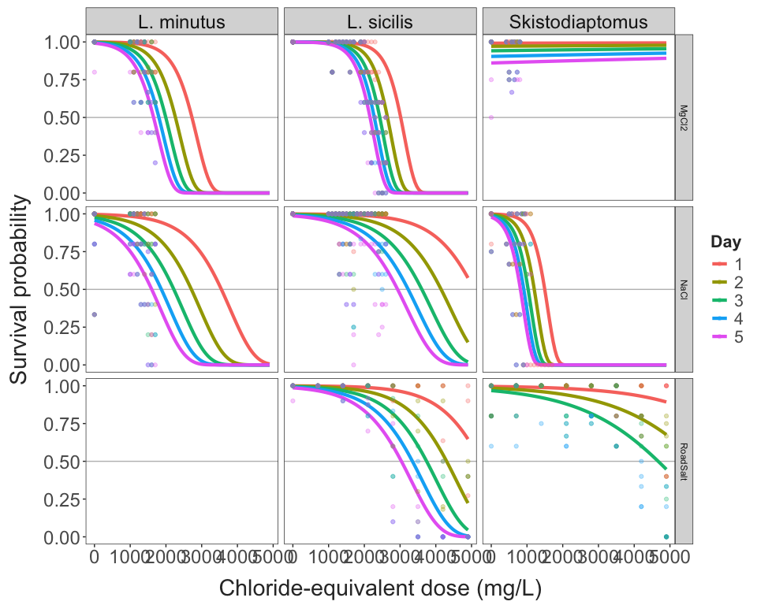
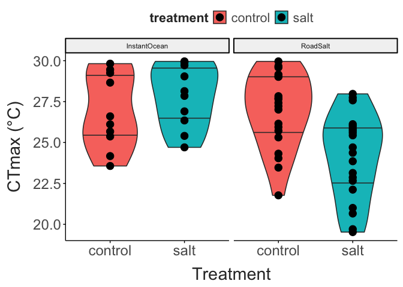
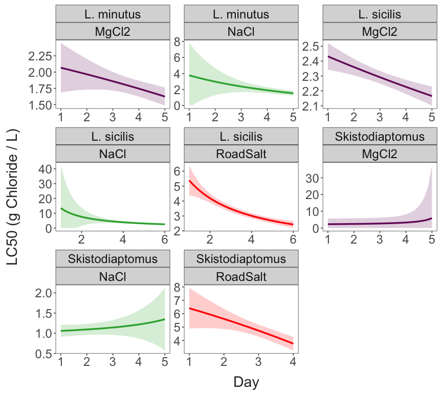
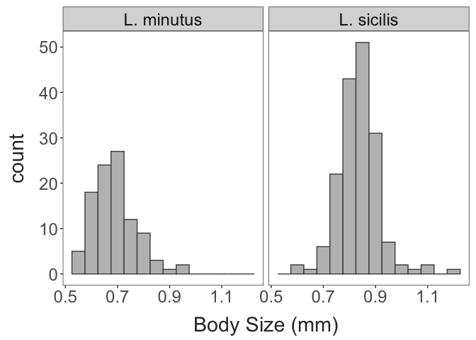

Effects of salinity acclimation on upper thermal limits of Lake
Champlain diaptomid copepods
================
2026-10-22

- [CTmax Data](#ctmax-data)
- [Survival Data](#survival-data)
  - [Sample Sizes](#sample-sizes)
  - [Survival](#survival)
  - [Weibull (accelerated failure time) survival
    model](#weibull-accelerated-failure-time-survival-model)
  - [Predicted survivorship across the salinity
    gradient](#predicted-survivorship-across-the-salinity-gradient)
  - [LC50 Values](#lc50-values)
- [Body Sizes](#body-sizes)

## CTmax Data

``` r
ctmax_model_data = ctmax_data %>% 
  mutate(treatment = case_when(
    dose_group == "Control" ~ "Control",
    dose_group == "Salt" ~ salt
  ))

ggplot(ctmax_model_data, aes(x = treatment, y = ctmax)) + 
  facet_wrap(species~.) + 
  geom_boxplot() + 
  geom_point(size = 1) + 
  theme_matt_facets()
```



Shown below are the sample sizes for the various salt-treatment
combinations. Fewer experiments were run with Instant Ocean, so the
sample sizes are smaller for this salt.

``` r

ctmax_data %>% 
  count(species, salt, dose_group) %>% 
  knitr::kable()
```

| species    | salt     | dose_group |   n |
|:-----------|:---------|:-----------|----:|
| L. minutus | MgCl2    | Control    |  11 |
| L. minutus | MgCl2    | Salt       |  39 |
| L. minutus | NaCl     | Control    |  14 |
| L. minutus | NaCl     | Salt       |  31 |
| L. sicilis | MgCl2    | Control    |  17 |
| L. sicilis | MgCl2    | Salt       |  43 |
| L. sicilis | NaCl     | Control    |  27 |
| L. sicilis | NaCl     | Salt       |  85 |
| L. sicilis | RoadSalt | Control    |  35 |
| L. sicilis | RoadSalt | Salt       |  35 |

A linear mixed effects model was used to examine variation in CTmax as a
function of salt type (Instant Ocean and road salt) and treatment
(control or salt-acclimated). We also examined the interaction between
these factors to determine whether the effect of treatment depended on
the type of salt used. Experiment date was included as a random effect
to control for any differences between collections or experimental
replicates.

``` r

salt.model = lmer(data = ctmax_model_data,
                  ctmax ~ species * treatment + (1|assay_date))

knitr::kable(car::Anova(salt.model, type = "III"))
```

|                   |       Chisq |  Df | Pr(\>Chisq) |
|:------------------|------------:|----:|------------:|
| (Intercept)       | 1037.588405 |   1 |   0.0000000 |
| species           |    3.331021 |   1 |   0.0679846 |
| treatment         |   11.870227 |   3 |   0.0078412 |
| species:treatment |    4.987240 |   2 |   0.0826104 |

The mixed effects model indicates that there was a significant
interaction between salt type and treatment. We examined this
interaction by calculating the marginal treatment means by salt type.
Shown below, there was no significant difference between treatment
groups in the Instant Ocean experiments, but there was a substantial
difference between treatment groups in the road salt experiments.

``` r
salt.means = emmeans::emmeans(salt.model, ~ treatment | species) %>% emmeans::contrast(method = "trt.vs.ctrl")

knitr::kable(salt.means)
```

| contrast           | species    |  estimate |        SE |       df |   t.ratio |   p.value |
|:-------------------|:-----------|----------:|----------:|---------:|----------:|----------:|
| MgCl2 - Control    | L. minutus | -1.729931 | 0.8960541 | 328.6123 | -1.930610 | 0.1009904 |
| NaCl - Control     | L. minutus | -1.251677 | 0.9536922 | 328.6998 | -1.312454 | 0.3246168 |
| RoadSalt - Control | L. minutus |        NA |        NA |       NA |        NA |        NA |
| MgCl2 - Control    | L. sicilis | -4.330819 | 0.7748613 | 286.0137 | -5.589154 | 0.0000002 |
| NaCl - Control     | L. sicilis | -2.563960 | 0.6183769 | 301.4532 | -4.146274 | 0.0001306 |
| RoadSalt - Control | L. sicilis | -2.101896 | 0.7553630 | 323.3560 | -2.782630 | 0.0161505 |

``` r

salt.means %>%  data.frame() %>% 
  ggplot(aes(y = contrast, x = estimate, colour = species)) + 
  geom_vline(xintercept = 0) + 
  geom_errorbar(aes(xmin = estimate - SE, xmax = estimate + SE),
                width = 0.2, linewidth = 1, 
                position = position_dodge(width = 0.4)) + 
  geom_point(size = 3, 
                position = position_dodge(width = 0.4)) + 
  theme_matt() + 
  theme(legend.position = "right")
```



## Survival Data

### Sample Sizes

``` r

species_surv_total = surv_data %>% 
  filter(exp_day == 1) %>% 
  group_by(species, salt) %>% 
  summarise(total_n = sum(initial))

surv_data |> filter(exp_day == 1, species == "L. sicilis", salt == "MgCl2") 
##       species    sex  salt treatment est_chloride replicate   exp_date ID initial hour ind_surv exp_day
## 1  L. sicilis female MgCl2      1100         1100         2 2026-01-23  5       5   24        1       1
## 2  L. sicilis female MgCl2      1600         1600         7 2026-01-23  5       5   24        1       1
## 3  L. sicilis female MgCl2      2100         2100         3 2026-01-30  4       5   25        1       1
## 4  L. sicilis female MgCl2      2100         2100         3 2026-01-30  5       5   25        1       1
## 5  L. sicilis female MgCl2      2200         2200         4 2026-01-30  5       5   25        1       1
## 6  L. sicilis female MgCl2      2400         2400         6 2026-01-30  4       5   25        1       1
## 7  L. sicilis female MgCl2      2400         2400         6 2026-01-30  5       5   25        1       1
## 8  L. sicilis female MgCl2      2500         2500         7 2026-01-30  4       5   25        1       1
## 9  L. sicilis female MgCl2      2500         2500         7 2026-01-30  5       5   25        1       1
## 10 L. sicilis female MgCl2      2600         2600         8 2026-01-30  2       5   25        1       1
## 11 L. sicilis female MgCl2      2600         2600         8 2026-01-30  3       5   25        1       1
## 12 L. sicilis female MgCl2      2600         2600         8 2026-01-30  4       5   25        1       1
## 13 L. sicilis female MgCl2      2600         2600         8 2026-01-30  5       5   25        1       1
## 14 L. sicilis female MgCl2      2300         2300         5 2026-02-04  5       5   24        1       1
## 15 L. sicilis female MgCl2      2400         2400         6 2026-02-04  4       5   24        1       1
## 16 L. sicilis female MgCl2      2400         2400         6 2026-02-04  5       5   24        1       1
## 17 L. sicilis female MgCl2      2500         2500         7 2026-02-04  2       5   24        1       1
## 18 L. sicilis female MgCl2      2500         2500         7 2026-02-04  3       5   24        1       1
## 19 L. sicilis female MgCl2      2500         2500         7 2026-02-04  4       5   24        1       1
## 20 L. sicilis female MgCl2      2500         2500         7 2026-02-04  5       5   24        1       1
## 21 L. sicilis female MgCl2      2600         2600         8 2026-02-04  3       5   24        1       1
## 22 L. sicilis female MgCl2      2600         2600         8 2026-02-04  4       5   24        1       1
## 23 L. sicilis female MgCl2      2600         2600         8 2026-02-04  5       5   24        1       1
## 24 L. sicilis female MgCl2      2000         2000         1 2026-02-09  5       5   24        1       1
## 25 L. sicilis female MgCl2      2100         2100         2 2026-02-09  4       5   24        1       1
## 26 L. sicilis female MgCl2      2100         2100         2 2026-02-09  5       5   24        1       1
## 27 L. sicilis female MgCl2      2000         2000         2 2026-03-18  5       5   26        1       1
## 28 L. sicilis female MgCl2      2100         2100         3 2026-03-18  5       5   26        1       1
## 29 L. sicilis female MgCl2      2200         2200         4 2026-03-18  5       5   26        1       1
## 30 L. sicilis female MgCl2      2300         2300         5 2026-03-18  3       5   26        1       1
## 31 L. sicilis female MgCl2      2300         2300         5 2026-03-18  4       5   26        1       1
## 32 L. sicilis female MgCl2      2300         2300         5 2026-03-18  5       5   26        1       1
## 33 L. sicilis female MgCl2      2400         2400         6 2026-03-18  5       5   26        1       1
## 34 L. sicilis female MgCl2      2500         2500         7 2026-03-18  4       5   26        1       1
## 35 L. sicilis female MgCl2      2500         2500         7 2026-03-18  5       5   26        1       1
## 36 L. sicilis female MgCl2      2600         2600         8 2026-03-18  2       5   26        1       1
## 37 L. sicilis female MgCl2      2600         2600         8 2026-03-18  3       5   26        1       1
## 38 L. sicilis female MgCl2      2600         2600         8 2026-03-18  4       5   26        1       1
## 39 L. sicilis female MgCl2      2600         2600         8 2026-03-18  5       5   26        1       1
## 40 L. sicilis female MgCl2      1900         1900         1 2026-03-25  5       5   22        1       1
## 41 L. sicilis female MgCl2      2100         2100         3 2026-03-25  5       5   22        1       1
## 42 L. sicilis female MgCl2      2200         2200         4 2026-03-25  3       5   22        1       1
## 43 L. sicilis female MgCl2      2200         2200         4 2026-03-25  4       5   22        1       1
## 44 L. sicilis female MgCl2      2200         2200         4 2026-03-25  5       5   22        1       1
## 45 L. sicilis female MgCl2      2300         2300         5 2026-03-25  4       4   22        1       1
## 46 L. sicilis female MgCl2      2400         2400         6 2026-03-25  3       5   22        1       1
## 47 L. sicilis female MgCl2      2400         2400         6 2026-03-25  4       5   22        1       1
## 48 L. sicilis female MgCl2      2400         2400         6 2026-03-25  5       5   22        1       1
## 49 L. sicilis female MgCl2      2500         2500         7 2026-03-25  4       5   22        1       1
## 50 L. sicilis female MgCl2      2500         2500         7 2026-03-25  5       5   22        1       1
## 51 L. sicilis female MgCl2      2600         2600         8 2026-03-25  3       4   22        1       1
## 52 L. sicilis female MgCl2      2600         2600         8 2026-03-25  4       4   22        1       1

species_surv_collections = surv_data %>% 
  filter(exp_day == 1) %>% 
  select(species, salt, exp_date) %>% 
  distinct() %>% 
  group_by(species, salt) %>% 
  count(name = "collections")

species_surv_mean = surv_data %>% 
  filter(exp_day == 1) %>% 
  group_by(species, salt, exp_date, replicate, est_chloride) %>% 
  summarise(n = sum(initial)) %>% 
  ungroup() %>% 
  group_by(species, salt) %>% 
  summarise(mean_n = mean(n))

species_surv_concentrations = surv_data %>% 
  select(species, salt, exp_date, est_chloride) %>% 
  distinct() %>% 
  group_by(species, salt, exp_date) %>% 
  count() %>% 
  ungroup() %>% 
  group_by(species, salt) %>% 
  summarise(mean_n_conditions = mean(n))


species_surv_total %>% 
  inner_join(species_surv_collections, by = c("species", "salt")) %>% 
  inner_join(species_surv_mean, by = c("species", "salt")) %>% 
  inner_join(species_surv_concentrations, by = c("species", "salt")) %>% 
  knitr::kable(digits = 2, caption = "Sample size information from the survivorship experiments. Shown here for each species and salt type are the total number of individuals monitored for survival, the number of collections (i.e. experimental replicates), and the average number of individuals per replicate, and the average number of conditions (chloride concentrations) employed during each replicate.")
```

| species         | salt     | total_n | collections | mean_n | mean_n_conditions |
|:----------------|:---------|--------:|------------:|-------:|------------------:|
| L. minutus      | MgCl2    |      35 |           3 |   5.00 |              9.00 |
| L. minutus      | NaCl     |      26 |           3 |   6.50 |              6.80 |
| L. sicilis      | MgCl2    |     257 |           6 |   9.52 |              8.14 |
| L. sicilis      | NaCl     |      14 |           2 |   4.67 |              6.27 |
| L. sicilis      | RoadSalt |     262 |           2 |  43.67 |              8.00 |
| Skistodiaptomus | NaCl     |     284 |           3 |  16.71 |              5.80 |
| Skistodiaptomus | RoadSalt |      58 |           1 |   7.25 |              8.00 |

Sample size information from the survivorship experiments. Shown here
for each species and salt type are the total number of individuals
monitored for survival, the number of collections (i.e. experimental
replicates), and the average number of individuals per replicate, and
the average number of conditions (chloride concentrations) employed
during each replicate.

``` r

species_ctmax_total = ctmax_data %>% 
  group_by(species, salt) %>% 
  count(name = "total")

species_ctmax_collections = ctmax_data %>% 
  select(species, salt, exp_rep) %>% 
  distinct() %>% 
  group_by(species, salt) %>% 
  count(name = "collections")

species_ctmax_mean = ctmax_data %>% 
  group_by(species, salt, exp_rep) %>% 
  count() %>% 
  ungroup() %>% 
  group_by(species, salt) %>% 
  summarise(mean_n = mean(n))

species_ctmax_total %>% 
  inner_join(species_ctmax_collections, by = c("species", "salt")) %>% 
  inner_join(species_ctmax_mean, by = c("species", "salt")) %>% 
  knitr::kable(digits = 2, caption = "Sample size information from the CTmax experiments. Shown here for each species and salt type are the total number of CTmax measurements, the number of collections (i.e. experimental replicates), and the average number of CTmax measurements per replicate")
```

| species    | salt     | total | collections | mean_n |
|:-----------|:---------|------:|------------:|-------:|
| L. minutus | MgCl2    |    50 |           4 |  12.50 |
| L. minutus | NaCl     |    45 |           4 |  11.25 |
| L. sicilis | MgCl2    |    60 |           4 |  15.00 |
| L. sicilis | NaCl     |   112 |           4 |  28.00 |
| L. sicilis | RoadSalt |    70 |           2 |  35.00 |

Sample size information from the CTmax experiments. Shown here for each
species and salt type are the total number of CTmax measurements, the
number of collections (i.e. experimental replicates), and the average
number of CTmax measurements per replicate

### Survival

### Weibull (accelerated failure time) survival model

A Weibull AFT model (`survival::survreg()`) was used to examine how salt
type, chloride dose, and species jointly affect survival time.

`L. minutus` was never tested with RoadSalt, so `species:salt` isn’t a
full 3x3 grid – one cell has zero observations. Fitting
`species * salt * est_chloride` directly leaves that cell’s interaction
terms unidentifiable (`NA` coefficients), and `predict.survreg()`
propagates those `NA`s to *every* row’s prediction (`0 * NA = NA` in R,
unlike `predict.lm()`, which degrades gracefully). Collapsing
`species:salt` into a single factor with `drop = TRUE` removes the empty
cell before fitting, so every remaining combination gets its own
identifiable intercept and dose slope.

``` r
surv_model_data = surv_data %>% 
  filter(hour > 0) %>%  # Weibull AFT models time on the log scale; hour == 0 is undefined
  mutate(
    species = factor(species),
    salt = factor(salt),
    exp_date = factor(exp_date),          # for clustering, not as a fixed effect -- too many levels
    group = interaction(species, salt, drop = TRUE)
  )
```

Before trusting the parametric fit, we check the Weibull constant-shape
assumption: a roughly straight, parallel set of lines on a complementary
log-log scale supports the Weibull model.

``` r
km_fit = survfit(Surv(hour, ind_surv) ~ species + salt, data = surv_model_data)

ggsurvplot(km_fit, data = surv_model_data, fun = "cloglog", facet.by = "salt")
```



``` r
weibull_fit = survreg(
  Surv(hour, ind_surv) ~ group * est_chloride,
  data = surv_model_data,
  dist = "weibull",
  cluster = exp_date
)

stopifnot("Aliased (NA) coefficients -- check for empty species x salt cells" =
            !anyNA(coef(weibull_fit)))

summary(weibull_fit)
## 
## Call:
## survreg(formula = Surv(hour, ind_surv) ~ group * est_chloride, 
##     data = surv_model_data, dist = "weibull", cluster = exp_date)
##                                                Value  Std. Err (Naive SE)     z       p
## (Intercept)                                 7.472481  0.911514   0.581635  8.20 2.4e-16
## groupL. sicilis.MgCl2                       1.577121  0.947170   0.739229  1.67   0.096
## groupSkistodiaptomus.MgCl2                 -1.622002  0.989738   0.659804 -1.64   0.101
## groupL. minutus.NaCl                       -1.156977  1.046172   0.647554 -1.11   0.269
## groupL. sicilis.NaCl                       -0.274767  1.052038   0.651220 -0.26   0.794
## groupSkistodiaptomus.NaCl                  -0.548260  1.089259   0.621371 -0.50   0.615
## groupL. sicilis.RoadSalt                   -0.278758  0.887573   0.602683 -0.31   0.753
## groupSkistodiaptomus.RoadSalt              -1.273433  0.884985   0.619075 -1.44   0.150
## est_chloride                               -0.001499  0.000598   0.000395 -2.51   0.012
## groupL. sicilis.MgCl2:est_chloride         -0.000379  0.000614   0.000441 -0.62   0.537
## groupSkistodiaptomus.MgCl2:est_chloride     0.001529  0.000661   0.000719  2.31   0.021
## groupL. minutus.NaCl:est_chloride           0.000673  0.000761   0.000451  0.88   0.376
## groupL. sicilis.NaCl:est_chloride           0.000746  0.000634   0.000419  1.18   0.239
## groupSkistodiaptomus.NaCl:est_chloride     -0.000867  0.000700   0.000438 -1.24   0.216
## groupL. sicilis.RoadSalt:est_chloride       0.000774  0.000591   0.000396  1.31   0.190
## groupSkistodiaptomus.RoadSalt:est_chloride  0.001131  0.000593   0.000399  1.91   0.056
## Log(scale)                                 -0.579117  0.088830   0.039251 -6.52 7.1e-11
## 
## Scale= 0.56 
## 
## Weibull distribution
## Loglik(model)= -2956.2   Loglik(intercept only)= -3389.9
##  Chisq= 867.4 on 15 degrees of freedom, p= 3.3e-175 
## (Loglikelihood assumes independent observations)
## Number of Newton-Raphson Iterations: 8 
## n= 1739
```

`survreg()` coefficients are on the log(time) scale; exponentiating
gives the multiplicative change in expected survival time (acceleration
factor) – values below 1 indicate shorter survival time.

``` r
knitr::kable(exp(coef(weibull_fit)), col.names = "Acceleration factor", digits = 3)
```

|                                            | Acceleration factor |
|:-------------------------------------------|--------------------:|
| (Intercept)                                |            1758.965 |
| groupL. sicilis.MgCl2                      |               4.841 |
| groupSkistodiaptomus.MgCl2                 |               0.198 |
| groupL. minutus.NaCl                       |               0.314 |
| groupL. sicilis.NaCl                       |               0.760 |
| groupSkistodiaptomus.NaCl                  |               0.578 |
| groupL. sicilis.RoadSalt                   |               0.757 |
| groupSkistodiaptomus.RoadSalt              |               0.280 |
| est_chloride                               |               0.999 |
| groupL. sicilis.MgCl2:est_chloride         |               1.000 |
| groupSkistodiaptomus.MgCl2:est_chloride    |               1.002 |
| groupL. minutus.NaCl:est_chloride          |               1.001 |
| groupL. sicilis.NaCl:est_chloride          |               1.001 |
| groupSkistodiaptomus.NaCl:est_chloride     |               0.999 |
| groupL. sicilis.RoadSalt:est_chloride      |               1.001 |
| groupSkistodiaptomus.RoadSalt:est_chloride |               1.001 |

### Predicted survivorship across the salinity gradient

Model-predicted survival curves (lines, by day) are overlaid on the
observed daily proportional survival (points). Predictions are
restricted per species x salt group to hours actually observed in that
group, so lines don’t extrapolate past the last check.

``` r
plot_days = daily_prop_data %>% 
  filter(day > 0) %>% 
  distinct(day) %>% 
  arrange(day) %>% 
  pull(day)

obs_hour_range = daily_prop_data %>% 
  group_by(species, salt) %>% 
  summarise(max_hour = max(hour), .groups = "drop")

group_map = surv_model_data %>% distinct(species, salt, group)

shape = 1 / weibull_fit$scale

pred_grid = obs_hour_range %>% 
  left_join(group_map, by = c("species", "salt")) %>% 
  tidyr::crossing(
    est_chloride = seq(0, max(surv_model_data$est_chloride, na.rm = TRUE), length.out = 100),
    day = plot_days
  ) %>% 
  mutate(hour = day * 24) %>% 
  filter(hour <= max_hour, hour > 0) %>% 
  select(-max_hour)

pred_grid = pred_grid %>% 
  mutate(
    lp = predict(weibull_fit, newdata = pred_grid, type = "lp"),
    surv_prob = 1 - pweibull(hour, shape = shape, scale = exp(lp))
  )

ggplot(pred_grid, aes(x = est_chloride, y = surv_prob, colour = factor(day))) + 
  facet_grid(salt ~ species, scales = "free_x") + 
  geom_hline(yintercept = 0.5, colour = "grey") + 
  geom_line(linewidth = 1.5) + 
  geom_point(
    data = daily_prop_data %>% filter(day %in% plot_days, day > 0, day < 6),
    aes(x = est_chloride, y = prop_surv, colour = factor(day)),
    alpha = 0.3
  ) + 
  labs(x = "Chloride-equivalent dose (mg/L)", y = "Survival probability", colour = "Day") + 
  theme_matt_facets()
```



Note: the model assumes a single shared Weibull shape parameter across
all species/salt/dose combinations (no `strata()` term). If the cloglog
diagnostic above shows clearly non-parallel lines across groups,
consider refitting with `strata(salt)` (or `strata(group)`) so each
group gets its own shape, and update the `shape` term above accordingly.

### LC50 Values

``` r

salt_cols = c("MgCl2" = "#761968", 
              "NaCl" = "#32ad3a", 
              "RoadSalt" = "red")

daily_prop_data %>% 
    filter(exp_day != 0) %>% 
  ggplot(aes(x = est_chloride, y = prop_surv, colour = species, weight = initial)) + 
  facet_grid(exp_day~salt, scales = "free") + 
  geom_point(aes(size = initial), alpha = 0.6)+ 
  geom_smooth(method = "glm",
              method.args = list(family = "quasibinomial"), 
              se = F, 
              linewidth = 2.5)
```



We previously fit a separate logistic regression for each species x salt
x day subset and extracted the LC50 (chloride concentration producing
50% mortality) from each with `dose.p()`. That approach has two
problems: (1) each
`glm(prop_surv ~ est_chloride, family = quasibinomial)` ignored how many
individuals each proportion was based on (`initial` ranges from 3 to 12
per replicate), so a 3-animal dish counted as much as a 12-animal dish;
and (2) fitting each day in total isolation, with no shared information
across days, gave wildly unstable estimates on days with little
mortality spread (e.g. an LC50 of 4.2x10^16 g Cl for one group) and
discarded the standard errors before plotting, so there was no way to
see which day-specific estimates were trustworthy.

Instead, we fit one quasibinomial model per species x salt combination,
using the actual survival counts (`cbind(n_surviving, n_dead)`, which
supplies the sample size directly rather than via `weights`) and an
`est_chloride * day` interaction. This pools information across days
within a group and lets us formally test whether the dose-response
relationship (and hence LC50) changes over time, via an F-test comparing
the model with and without the interaction (appropriate here since
`quasibinomial` doesn’t have a well-defined likelihood for a chi-square
LRT).

``` r
lc50_models = daily_prop_data %>% 
  filter(day != 0) %>% 
  mutate(n_dead = initial - n_surviving) %>% 
  group_by(species, salt) %>% 
  nest() %>% 
  mutate(
    model_full = map(data, ~ glm(cbind(n_surviving, n_dead) ~ est_chloride * day,
                                  data = .x, family = quasibinomial)),
    model_red  = map(data, ~ glm(cbind(n_surviving, n_dead) ~ est_chloride + day,
                                  data = .x, family = quasibinomial)),
    interaction_test = map2(model_red, model_full, ~ anova(.x, .y, test = "F"))
  )
```

``` r
interaction_summary = lc50_models %>% 
  mutate(
    f_stat = map_dbl(interaction_test, ~ .x$F[2]),
    p_value = map_dbl(interaction_test, ~ .x$`Pr(>F)`[2])
  ) %>% 
  ungroup() %>% 
  mutate(p_adj = p.adjust(p_value, method = "holm")) %>%  # 8 tests, one per species x salt
  dplyr::select(species, salt, f_stat, p_value, p_adj)

knitr::kable(interaction_summary, digits = 3,
             caption = "F-test for the est_chloride:day interaction (does the dose-response relationship change over time?) within each species x salt model. p_adj applies a Holm correction across the 8 tests.")
```

| species         | salt     | f_stat | p_value | p_adj |
|:----------------|:---------|-------:|--------:|------:|
| L. sicilis      | RoadSalt | 11.137 |   0.001 | 0.008 |
| Skistodiaptomus | RoadSalt |  0.161 |   0.689 | 1.000 |
| Skistodiaptomus | NaCl     |  2.889 |   0.092 | 0.632 |
| Skistodiaptomus | MgCl2    |  0.586 |   0.446 | 1.000 |
| L. minutus      | NaCl     |  0.317 |   0.574 | 1.000 |
| L. sicilis      | NaCl     |  2.882 |   0.090 | 0.632 |
| L. minutus      | MgCl2    |  0.076 |   0.784 | 1.000 |
| L. sicilis      | MgCl2    |  0.274 |   0.601 | 1.000 |

F-test for the est_chloride:day interaction (does the dose-response
relationship change over time?) within each species x salt model. p_adj
applies a Holm correction across the 8 tests.

Only `L. sicilis` x RoadSalt shows a significant chloride:day
interaction after correcting for multiple comparisons; the others are
suggestive at best (uncorrected p ~ 0.09 for `L. sicilis`/NaCl and
`Skistodiaptomus`/NaCl) or show no evidence of a time trend.

To visualize this, we convert each group’s fitted intercept/slope-by-day
into an LC50(day) trajectory with a delta-method confidence interval
(the same approach `dose.p()` uses for a single model, extended here to
a day-varying intercept and slope), evaluated only across the days
actually observed within each species x salt group.

``` r
lc50_trajectory = function(model, days) {
  cf = coef(model)
  vc = vcov(model)
  b0 = cf[["(Intercept)"]]; b1 = cf[["est_chloride"]]
  b2 = cf[["day"]];         b3 = cf[["est_chloride:day"]]

  map_dfr(days, function(d) {
    N = -(b0 + b2 * d)
    D = b1 + b3 * d
    lc50 = N / D
    grad = c(
      "(Intercept)"      = -1 / D,
      "est_chloride"     = -N / D^2,
      "day"              = -d / D,
      "est_chloride:day" = -N * d / D^2
    )
    grad = grad[rownames(vc)]
    se = sqrt(as.numeric(t(grad) %*% vc %*% grad))
    tibble(day = d, lc50 = lc50, se = se)
  })
}

day_range = daily_prop_data %>% 
  filter(day != 0) %>% 
  group_by(species, salt) %>% 
  summarise(min_day = min(day), max_day = max(day), .groups = "drop")

lc50_traj = lc50_models %>% 
  dplyr::select(species, salt, model_full) %>% 
  left_join(day_range, by = c("species", "salt")) %>% 
  mutate(
    traj = pmap(list(model_full, min_day, max_day), function(m, lo, hi) {
      lc50_trajectory(m, seq(lo, hi, length.out = 30))
    })
  ) %>% 
  dplyr::select(species, salt, traj) %>% 
  unnest(traj) %>% 
  ungroup() %>% 
  mutate(
    lc50_g = lc50 / 1000,
    lwr_g = pmax((lc50 - 1.96 * se) / 1000, 0),
    upr_g = (lc50 + 1.96 * se) / 1000
  )
```

``` r

ggplot(lc50_traj, aes(x = day, y = lc50_g, colour = salt, fill = salt)) + 
  facet_wrap(species ~ .) + 
  geom_ribbon(aes(ymin = lwr_g, ymax = upr_g), alpha = 0.2, colour = NA) + 
  geom_line(linewidth = 1.2) + 
  scale_color_manual(values = salt_cols) + 
  scale_fill_manual(values = salt_cols) + 
  coord_cartesian(ylim = c(0,15)) + 
  labs(x = "Day", y = "LC50 (g Chloride / L)") + 
  theme_matt_facets() 
```



The ribbon width makes the earlier instability visible rather than
hiding it: for example, the `L. sicilis`/NaCl and
`Skistodiaptomus`/MgCl2 trajectories carry very wide intervals at the
days where the interaction test above was non-significant, meaning those
day-to-day changes in LC50 shouldn’t be over-interpreted. The `RoadSalt`
trajectories (and `L. sicilis`/MgCl2) are comparatively well-identified
across the full day range.

## Body Sizes

``` r

size_data %>% 
  filter(species != "Other") %>% 
ggplot(aes(x = size)) + 
  facet_wrap(species~.) + 
  geom_histogram(fill = "grey", colour = "grey30",
                 binwidth = 0.05) + 
  labs(x = "Body Size (mm)") + 
  theme_matt_facets()
```


